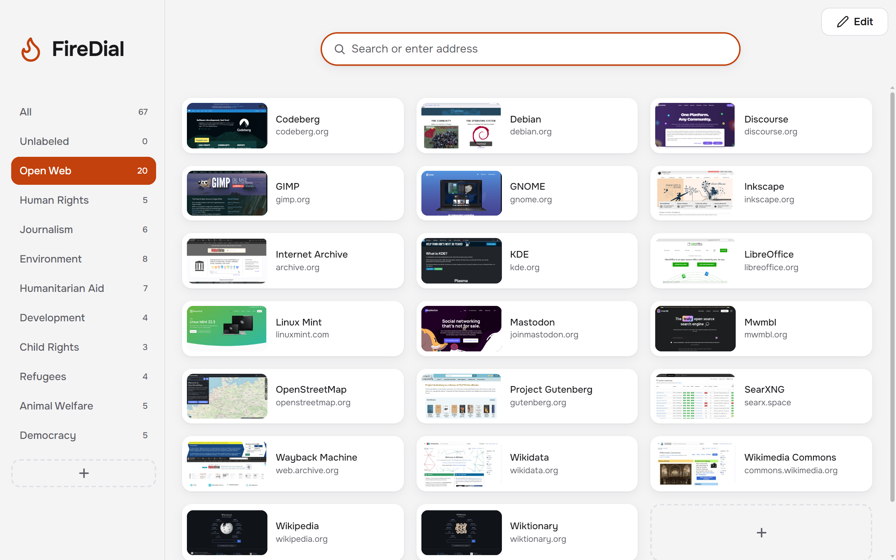
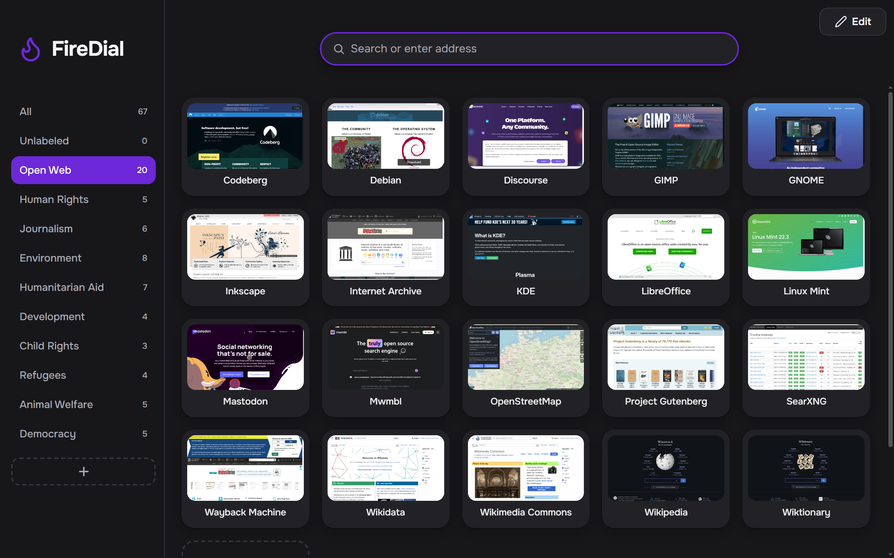
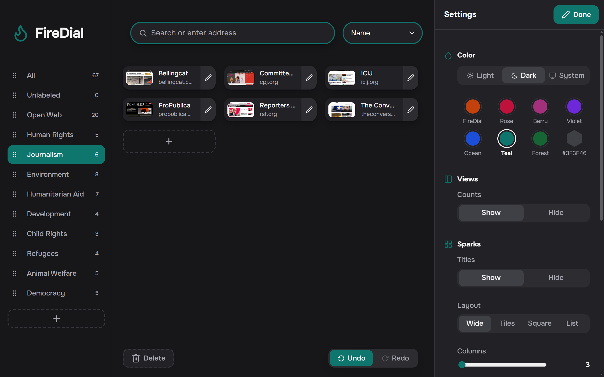
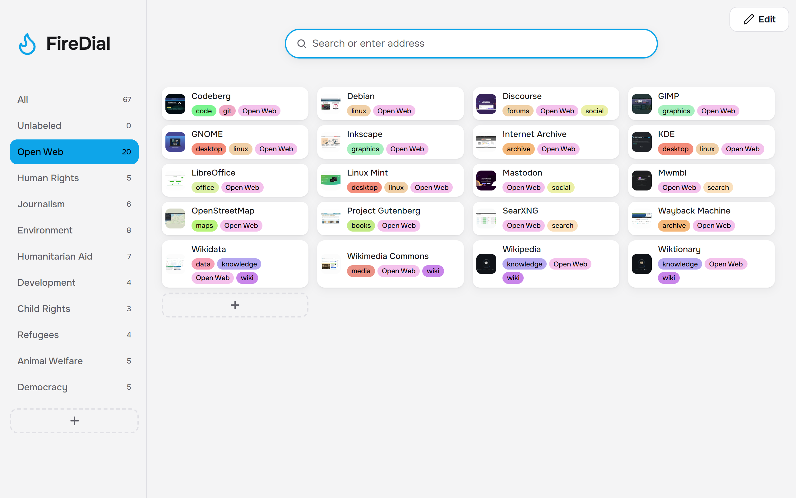

# FireDial

Minimal speed dial for your bookmarks in Firefox and Chrome! Completely free and open source: no ads, no account, no tracking, no BS.



<p>
  
  
  
</p>

## Install

- Chrome: https://chromewebstore.google.com/detail/khflkpkeicdbceieebokdclnedonmphk
- Firefox: https://addons.mozilla.org/firefox/addon/firedial

## Usage

- Right-click a page or link (in Firefox also a tab): **Add to FireDial**.
- **Edit**: settings. **About**: shortcuts, bookmark import.
- Views filter sparks by label, e.g. _Work or News_, _all but Private_.
- Sparks are bookmarks (**Other Bookmarks → FireDial**), so the browser's sync carries them. Images stay local.

## Build

```bash
git clone https://github.com/sebastianstucke87/FireDial.git
cd FireDial
npm ci
npm run build
```

The builds are in `dist/firefox` and `dist/chrome`. `npm test` runs the checks and the tests in headless Firefox and Chrome.

To load your build until Firefox restarts:

1. Open `about:debugging#/runtime/this-firefox`
2. Click `Load Temporary Add-on...`
3. Pick `dist/firefox/manifest.json`

To load it in Chrome:

1. Open `chrome://extensions`
2. Turn on `Developer mode`
3. Click `Load unpacked` and pick `dist/chrome`

## Trust

- FireDial is only published at `github.com/sebastianstucke87/FireDial`, `chromewebstore.google.com/detail/khflkpkeicdbceieebokdclnedonmphk` and `addons.mozilla.org/firefox/addon/firedial`. Anything else claiming to be FireDial is fake; report it.
- FireDial is not for sale.
- Something odd? [Open an issue](https://github.com/sebastianstucke87/FireDial/issues) or [report a vulnerability](https://github.com/sebastianstucke87/FireDial/security/advisories/new).
